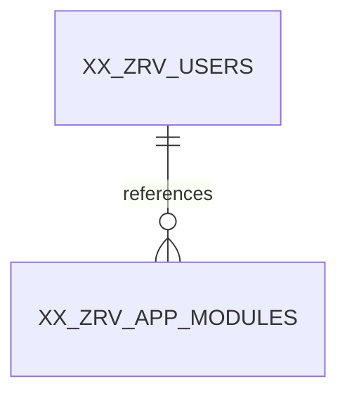

# XX_ZRV_APP_MODULES — Database Design & Security Reference
**Design status:** **APPROVED AND LOCKED** · **Sequence:** 03/11 · **Columns:** 10 · **Approval:** 17 October 2026 · **Document purpose:** technical preservation, not schema change.

> **Source status:** Table columns and approvals were reconciled against the locked 17-Oct-2026 RBAC discussions and the previously generated, unexecuted `Zamil_Revamp_RBAC_11_Tables_Oracle_ADW.sql` snapshot. Architecture document 01 and API document 02 were discoverable in the project Library; the full text of architecture documents 03–06 was **not available for independent byte-level verification in this run**. Shared standards cited below are corroborated by the RBAC discussion; any unverified detail is explicitly identified. No Oracle database was accessed.

## A. Overview and responsibility
**Business and technical purpose.** Defines the top-level functional security grouping for resources (for example PRODUCTION, INVENTORY, QUALITY). Its DISPLAY_ORDER supports default module ordering.
**Why it is necessary.** Resources would lack a coherent module grouping and centralized module deactivation boundary.
**When and where used.** Used in RBAC resource administration, effective permission joins and React module-list presentation.
**Boundary in the RBAC system.** Functional application module catalog. This table participates in the approved 11-table centralized authorization design. It is not a source of Oracle Fusion employee profile attributes. Its responsibilities do not imply direct role or permission grants beyond the approved foreign-key model.

## B. Approved column catalog
| # | Column | Exact Oracle datatype | Nullability | Default / generation | Key / important validation | Representative value |
|---:|---|---|---|---|---|---|
| 1 | `MODULE_ID` | `NUMBER(19,0)` | NOT NULL | `GENERATED ALWAYS AS IDENTITY` | PK; NOT NULL / required; identity primary key; verify corresponding FK where present | `10` |
| 2 | `MODULE_CODE` | `VARCHAR2(60 CHAR)` | NOT NULL | `—` | —; NOT NULL / required; uppercase, trimmed, A–Z / 0–9 / underscore, starts with a letter | `PRODUCTION` |
| 3 | `MODULE_NAME` | `VARCHAR2(120 CHAR)` | NOT NULL | `—` | —; NOT NULL / required; nonblank after trim | `Production` |
| 4 | `DESCRIPTION` | `VARCHAR2(500 CHAR)` | NULL allowed | `—` | —; Type/length/nullability plus table-specific business validation. | `Work orders and production reporting` |
| 5 | `DISPLAY_ORDER` | `NUMBER(5,0)` | NOT NULL | `0` | —; NOT NULL / required; nonnegative | `20` |
| 6 | `IS_ACTIVE` | `NUMBER(1,0)` | NOT NULL | `1` | —; NOT NULL / required; 0 or 1 | `1` |
| 7 | `CREATED_AT` | `TIMESTAMP(6) WITH TIME ZONE` | NOT NULL | `(SYSTIMESTAMP AT TIME ZONE 'UTC')` | —; NOT NULL / required; UTC event timestamp | `2026-10-17T07:30:00+00:00` |
| 8 | `CREATED_BY` | `NUMBER(19,0)` | NULL allowed | `—` | FK; verify corresponding FK where present | `1` |
| 9 | `UPDATED_AT` | `TIMESTAMP(6) WITH TIME ZONE` | NULL allowed | `—` | —; Type/length/nullability plus table-specific business validation. | `NULL` |
| 10 | `UPDATED_BY` | `NUMBER(19,0)` | NULL allowed | `—` | FK; verify corresponding FK where present | `NULL` |

### Column-by-column semantics, population and mutability
**`MODULE_ID` — `NUMBER(19,0)`.** Unique module identifier and owning module foreign key for protected resources. **Population/change:** Generated on INSERT by Oracle; must never be rewritten or supplied by ordinary application clients. **Validation/security:** NOT NULL / required; identity primary key; verify corresponding FK where present **Example:** `10`.

**`MODULE_CODE` — `VARCHAR2(60 CHAR)`.** Stable uppercase module identifier used for functional grouping; globally unique. **Population/change:** Set on provisioning/registration after normalization; treat as stable after first use and review changes that would affect references. **Validation/security:** NOT NULL / required; uppercase, trimmed, A–Z / 0–9 / underscore, starts with a letter **Example:** `PRODUCTION`.

**`MODULE_NAME` — `VARCHAR2(120 CHAR)`.** Display name for module administration and navigation. **Population/change:** Set on creation; any permitted change follows feature validation, RBAC authorization and audit rules. **Validation/security:** NOT NULL / required; nonblank after trim **Example:** `Production`.

**`DESCRIPTION` — `VARCHAR2(500 CHAR)`.** Optional business-purpose explanation; no secrets or sensitive personal data. **Population/change:** Set on creation; any permitted change follows feature validation, RBAC authorization and audit rules. **Validation/security:** Type/length/nullability plus table-specific business validation. **Example:** `Work orders and production reporting`.

**`DISPLAY_ORDER` — `NUMBER(5,0)`.** Nonnegative UI ordering metadata for top-level modules; has no authorization meaning. **Population/change:** Set on creation; any permitted change follows feature validation, RBAC authorization and audit rules. **Validation/security:** NOT NULL / required; nonnegative **Example:** `20`.

**`IS_ACTIVE` — `NUMBER(1,0)`.** Binary lifecycle switch for functional application module catalog (1 active, 0 inactive); deactivation preserves references and history. A disabled object has no effective authority through this record. **Population/change:** Defaults to 1; authorized administrators may switch 1↔0 with security audit and prompt effective-permission refresh. **Validation/security:** NOT NULL / required; 0 or 1 **Example:** `1`.

**`CREATED_AT` — `TIMESTAMP(6) WITH TIME ZONE`.** UTC timestamp of row creation, with database default SYSTIMESTAMP AT TIME ZONE UTC. In the audit-log table specifically, it represents event recording time. **Population/change:** Set by Oracle UTC default if omitted; creation value must remain unchanged. **Validation/security:** NOT NULL / required; UTC event timestamp **Example:** `2026-10-17T07:30:00+00:00`.

**`CREATED_BY` — `NUMBER(19,0)`.** Authenticated account responsible for creation where attributable. Nullable for approved bootstrap/self-service/system cases; USER_SESSIONS requires authenticated account, matching USER_ID. **Population/change:** Set from validated actor context at INSERT; do not rewrite later. **Validation/security:** verify corresponding FK where present **Example:** `1`.

**`UPDATED_AT` — `TIMESTAMP(6) WITH TIME ZONE`.** UTC timestamp of last permitted record modification, nullable and initially NULL. The RBAC audit-log table is a special case where it must always remain NULL. **Population/change:** Initially NULL; set to the UTC change instant only when a real modification succeeds. **Validation/security:** Type/length/nullability plus table-specific business validation. **Example:** `NULL`.

**`UPDATED_BY` — `NUMBER(19,0)`.** Authenticated account responsible for last permitted modification when attributable; nullable. The RBAC audit-log table is a special case where it must always remain NULL. **Population/change:** Initially NULL; set to validated actor only on permitted modification. **Validation/security:** verify corresponding FK where present **Example:** `NULL`.

## C. Keys, constraints, validation and indexes
The following constraint names and rules are transcribed from the previously prepared, **unexecuted** DDL snapshot. Database constraints protect row integrity; eligibility and authorization checks remain backend responsibilities.

| Constraint | Approved rule / purpose | Failure prevented |
|---|---|---|
| `PK_ZRV_MOD` | Establishes immutable row identity; prevents ambiguous joins and records. `PRIMARY KEY (MODULE_ID)` | Without it, dependent FKs and precise event/row references would fail. |
| `UQ_ZRV_MOD_CODE` | Prohibits duplicate keys or assignment pairs, including previously deactivated rows. `UNIQUE (MODULE_CODE)` | Without it, repeated grants, inconsistent logins or duplicate policy decisions could occur. |
| `CK_ZRV_MOD_CODE` | Enforces canonical, stable machine-readable codes. `CHECK ( MODULE_CODE = TRIM(MODULE_CODE) AND REGEXP_LIKE(MODULE_CODE, '^[A-Z][A-Z0-9_]*$', 'c') )` | Without it, inconsistent casing or spacing could make authorization lookups disagree. |
| `CK_ZRV_MOD_NAME` | Enforces a reviewed data-consistency invariant in the approved DDL. `CHECK (TRIM(MODULE_NAME) IS NOT NULL)` | Without it, invalid or internally inconsistent values may enter the data model. |
| `CK_ZRV_MOD_ORDER` | Enforces a reviewed data-consistency invariant in the approved DDL. `CHECK (DISPLAY_ORDER >= 0)` | Without it, invalid or internally inconsistent values may enter the data model. |
| `CK_ZRV_MOD_ACTIVE` | Restricts the column to agreed lifecycle or decision values. `CHECK (IS_ACTIVE IN (0, 1))` | Without it, the backend could receive unknown states and make unsafe policy assumptions. |
| `FK_ZRV_MOD_CBY` | Guarantees an existing referenced parent at insertion/update; ordinary deletion of referenced parent is restricted. `FOREIGN KEY (CREATED_BY) REFERENCES XX_ZRV_USERS (USER_ID)` | Without it, orphan memberships, permissions or unattributable audit references would accumulate. |
| `FK_ZRV_MOD_UBY` | Guarantees an existing referenced parent at insertion/update; ordinary deletion of referenced parent is restricted. `FOREIGN KEY (UPDATED_BY) REFERENCES XX_ZRV_USERS (USER_ID)` | Without it, orphan memberships, permissions or unattributable audit references would accumulate. |

**NOT NULL and defaults.** `NOT NULL` requirements are listed per column above. Oracle-generated identity IDs are not user-supplied. Explicit non-identity defaults in this table: `DISPLAY_ORDER` = `0`, `IS_ACTIVE` = `1`, `CREATED_AT` = `(SYSTIMESTAMP AT TIME ZONE 'UTC')`. SQL CHECK constraints do not replace Joi validation or safe backend state transitions.

**Indexes.** Oracle normally supplies supporting indexes for PK/UNIQUE constraints; do not create duplicate equivalents. The separately approved/indexed reverse lookups are:
No additional standalone index was approved for this table beyond its PK/UNIQUE support.

**Constraint enforcement boundary.** A FK proves a parent row exists, not that the parent remains active; an expiry CHECK cannot consult the continuously changing clock; and a row CHECK cannot evaluate effective permissions across many tables. Those requirements belong in transaction-aware Node.js services and middleware.

## D. Relationships and referential integrity
**Parent tables:** [XX_ZRV_USERS](XX_ZRV_USERS.md).
**Child tables referencing this table:** [XX_ZRV_RESOURCES](XX_ZRV_RESOURCES.md).

| FK constraint | Child column | Parent key | Relationship meaning |
|---|---|---|---|
| `FK_ZRV_MOD_CBY` | `XX_ZRV_APP_MODULES.CREATED_BY` | `XX_ZRV_USERS.USER_ID` | Many XX_ZRV_APP_MODULES records can reference one parent record; nullability follows the column definition. |
| `FK_ZRV_MOD_UBY` | `XX_ZRV_APP_MODULES.UPDATED_BY` | `XX_ZRV_USERS.USER_ID` | Many XX_ZRV_APP_MODULES records can reference one parent record; nullability follows the column definition. |

**Direct parent relationship sketch** (conceptual cardinalities; nullable audit actor FKs may be absent):


**Insertion/deletion rules:** Create core parents before dependent relationships. Oracle FKs prevent inserting nonexistent parent keys and ordinarily prevent deleting parents that still have referencing rows. Approved administration favors deactivation, revocation or expiration over hard deletion; never enable cascade deletion of access/audit history by convenience. Join through approved numeric IDs for RBAC and through verified employee number for Fusion profile context.

## E. Operational usage and realistic example
**Create:** Authorized administrator adds a stable uppercase module code, display name and ordering.
**Read:** Used by resource ownership checks, authorization path and navigation catalog.
**Update:** Name, description, order and IS_ACTIVE can be managed; MODULE_CODE should remain stable.
**Deactivate/revoke/expire:** IS_ACTIVE=0 disables ordinary access to all child resources, even when permissions still exist; keep referential history.

**Illustrative record** (not real employee or operational data; credential secrets always redacted):
| Column | Sample value |
|---|---|
| `MODULE_ID` | `10` |
| `MODULE_CODE` | `PRODUCTION` |
| `MODULE_NAME` | `Production` |
| `DESCRIPTION` | `Work orders and production reporting` |
| `DISPLAY_ORDER` | `20` |
| `IS_ACTIVE` | `1` |
| `CREATED_AT` | `2026-10-17T07:30:00+00:00` |
| `CREATED_BY` | `1` |
| `UPDATED_AT` | `NULL` |
| `UPDATED_BY` | `NULL` |

**How to interpret the example.** This is one conceptual record in the Zamil-Revamp RBAC model, linked only to demonstrative other records (for example local user 105, production role 20, resource 101). A `NULL` sample is deliberately an allowed absence, not proof that the field is always NULL. Identifiers, employee numbers, times and client IP addresses are illustrative.

## F. Complete record lifecycle
1. **Pre-create:** Validate relevant parents, eligibility, required field types and authorization before issuing database work. Authorized administrator adds a stable uppercase module code, display name and ordering.
2. **Create:** Use a bind-variable INSERT omitting generated IDs and allowing the UTC default; populate verified actor and required business fields. Insert any critical security audit event in the same transaction.
3. **Read/use:** Used by resource ownership checks, authorization path and navigation catalog.
4. **Modify:** Name, description, order and IS_ACTIVE can be managed; MODULE_CODE should remain stable. Enforce actual state transitions and audit actor metadata.
5. **End effective life:** IS_ACTIVE=0 disables ordinary access to all child resources, even when permissions still exist; keep referential history.
6. **Historical/retention treatment:** Preserve referenced security history under the approved non-cascade approach; retention duration, archival implementation and privileged purge access are unresolved policy decisions unless stated otherwise below.

## G. Security, access control and abuse prevention
**Approved security and business invariants:**
- MODULE_CODE is globally unique, uppercase and trimmed.
- DISPLAY_ORDER is a nonnegative NUMBER(5,0), defaults to zero and does not require uniqueness.
- Module inactive globally blocks its resources; React hiding is informational, not enforcement.
- Module definition is neither an individual user grant nor a React route registry.

**Database vs backend responsibilities.** Oracle enforces identity, uniqueness, FK references, supported CHECK conditions and exact typed values. The Node.js service must enforce the right administrator authority, current account/Fusion employee eligibility, active modules/resources/permissions, direct ALLOW/DENY precedence, mandatory MFA, record-level/organizational policy, rate limiting, secure time windows and cross-row concurrency. React may render allowed actions but is never the authoritative policy enforcement point.
**Abuse cases:** protect against unauthorized self-assignment, stale access after revocation, tampered UI requests, forged identities, insecure logging and race conditions. Use parameterized SQL and least-privilege Oracle runtime grants. Password, TOTP and bearer-token values must never appear in logs or error details.

## H. Audit fields and timezone conventions
The approved shared standard uses **UTC exact event instants**, persisted as `TIMESTAMP(6) WITH TIME ZONE`, and presentation in **Asia/Riyadh** for Saudi users. The India development workstation timezone must not change stored instants. No event timestamp here is a date-only Oracle DATE business value.

| Field | Population rule | Nullability / lifecycle |
|---|---|---|
| `CREATED_AT` | Set by Oracle UTC default if omitted; creation value must remain unchanged. | NOT NULL; UTC default. |
| `CREATED_BY` | Set from validated actor context at INSERT; do not rewrite later. | NULL permitted; no default. |
| `UPDATED_AT` | Initially NULL; set to the UTC change instant only when a real modification succeeds. | NULL permitted; no default. |
| `UPDATED_BY` | Initially NULL; set to validated actor only on permitted modification. | NULL permitted; no default. |

## I. Locked decisions, rejected alternatives, and unresolved items
### Approved and locked — do not change without explicit authorization
- MODULE_CODE is globally unique, uppercase and trimmed.
- DISPLAY_ORDER is a nonnegative NUMBER(5,0), defaults to zero and does not require uniqueness.
- Module inactive globally blocks its resources; React hiding is informational, not enforcement.
- Module definition is neither an individual user grant nor a React route registry.

### Discussed and explicitly excluded from this table
- MODULE_ROUTE, ICON_NAME (React owns routing/icons).
- PARENT_MODULE_ID (flat module catalog approved).
- USER_ID, ROLE_ID, PERMISSION_ID (relationships belong elsewhere).
- DEPARTMENT_ID (Fusion owns employee organization information).

### Not Confirmed / Requires Clarification / Not Yet Decided
- **Open item:** Approved production module seed list, and exact React menu mapping: Not Yet Decided.

### Decision rationale and trade-off
The table is intentionally restricted to **functional application module catalog**. Adding the rejected fields would either duplicate normalized RBAC/Fusion facts, create conflicting sources of truth, or couple access controls to presentation or transport details. The compact design allows controlled expansion **only through a separately approved design change**. The present document records approval history; recommendations or open items are not retroactively approved.

## J. Node.js / Express / React / Oracle integration
**Expected service behavior.** Used in RBAC resource administration, effective permission joins and React module-list presentation. The owning feature service verifies policy and transactions; its repository performs bounded Oracle SQL using binds and shared pooled connections. Controllers validate request contracts using Joi and return sanitized standardized responses. Auth/session and resource/action checks belong in centralized middleware plus domain-level business services. **No API URL is defined or approved by this document.**
**Typical repository operations.** Authorized administrator adds a stable uppercase module code, display name and ordering. Used by resource ownership checks, authorization path and navigation catalog. Name, description, order and IS_ACTIVE can be managed; MODULE_CODE should remain stable.
**Transaction responsibility.** Services own one Oracle connection per transaction and commit related security state/audit inserts together when success must be atomic. For failed attempts, record an independent audit event rather than losing it to a business rollback. Never infer external Fusion integration atomicity from an Oracle local transaction.
**React responsibilities.** Consume safe projected account/permission metadata only, never hash material, shared secrets, session bearer tokens or privileged raw audit details. Components display roles/permissions for usability; the backend repeats every mandatory check.
**Error classes to test.** Invalid input (400-style validation), missing parent/not found, duplicate unique key/conflict, inactive or ineligible account, unauthorized action (403), expired/revoked credential, concurrency conflict, Oracle transaction failure and audit-write failure. Final status codes and route contracts remain feature-specific and **not approved here**.

## K. Edge cases and expected handling
- **Case:** Duplicate MODULE_CODE or negative DISPLAY_ORDER fails. **Expected:** Reject unsafe state, preserve referenced rows, report a safe error and create a security event where required.
- **Case:** Turning off PRODUCTION disables child work-order actions in backend. **Expected:** Reject unsafe state, preserve referenced rows, report a safe error and create a security event where required.
- **Case:** Changing DISPLAY_ORDER changes presentation only, not permission. **Expected:** Reject unsafe state, preserve referenced rows, report a safe error and create a security event where required.

**Concurrency:** Where multiple administrators or authentication requests act simultaneously, uniqueness and Oracle transactions are the last line of integrity defense; service-level guards must re-check current state while holding appropriate locks or implementing safe atomic updates. **Not Confirmed:** the final distributed cache invalidation and retry strategy.

## L. Implementation checklist and verification guidance
**Dependency and creation-order guidance:** `XX_ZRV_USERS` first (self-reference permitted), then ROLES and APP_MODULES, RESOURCES, PERMISSIONS, USER_ROLES, ROLE_PERMISSIONS, USER_PERMISSION_OVERRIDES, USER_SESSIONS, ACCOUNT_ACTION_TOKENS, RBAC_AUDIT_LOGS. Existing Fusion master is external, not created here. This order follows the previously produced SQL script; no runtime DDL is executed by these documents.

**Database verification (planned, not executed):** inspect USER_TAB_COLUMNS, USER_CONSTRAINTS, USER_CONS_COLUMNS and USER_INDEXES for exact datatypes/defaults/nullable flags, FK parent names and checks; test required/invalid duplicate inserts in nonproduction and verify error outcomes. Confirm data dictionary and Oracle version compatibility before any deployment.

**Specific acceptance tests (planned, not executed):
- [ ] Duplicate MODULE_CODE or negative DISPLAY_ORDER fails.
- [ ] Turning off PRODUCTION disables child work-order actions in backend.
- [ ] Changing DISPLAY_ORDER changes presentation only, not permission.

**Cross-layer verification (planned, not executed):** exercise normal and failure workflows using Node.js native test runner and Supertest, plus isolated Oracle test data. Verify backend denial even when React controls are manipulated; check JSON/log redaction, role-cache freshness, safe ID precision, and precise UTC/KSA conversions. Record evidence of tests actually executed and never call planned checks "passed".

**New recommendations, not approvals:** validate physical Oracle CHECK/DEFAULT compilation on the target ADW before running in production, secure least-privilege runtime grants, size operational log retention after actual workload measurement, and document an approved rollback/reconciliation plan. None modifies a locked field.

## M. CREATE TABLE statement — documented existing DDL snapshot
> **IMPORTANT:** The statement below is reproduced verbatim from the previously generated SQL file for technical reference. It has **not been executed or compiled against your Oracle instance**, and its inclusion is not approval to change the schema. Standalone CREATE TABLE may depend on parent tables being present; supporting indexes and append-only trigger, where applicable, follow separately.
```sql
CREATE TABLE XX_ZRV_APP_MODULES (
    MODULE_ID                   NUMBER(19,0) GENERATED ALWAYS AS IDENTITY,
    MODULE_CODE                 VARCHAR2(60 CHAR) NOT NULL,
    MODULE_NAME                 VARCHAR2(120 CHAR) NOT NULL,
    DESCRIPTION                 VARCHAR2(500 CHAR),
    DISPLAY_ORDER               NUMBER(5,0) DEFAULT 0 NOT NULL,
    IS_ACTIVE                   NUMBER(1,0) DEFAULT 1 NOT NULL,
    CREATED_AT                  TIMESTAMP(6) WITH TIME ZONE DEFAULT (SYSTIMESTAMP AT TIME ZONE 'UTC') NOT NULL,
    CREATED_BY                  NUMBER(19,0),
    UPDATED_AT                  TIMESTAMP(6) WITH TIME ZONE,
    UPDATED_BY                  NUMBER(19,0),
    CONSTRAINT PK_ZRV_MOD PRIMARY KEY (MODULE_ID),
    CONSTRAINT UQ_ZRV_MOD_CODE UNIQUE (MODULE_CODE),
    CONSTRAINT CK_ZRV_MOD_CODE CHECK (
        MODULE_CODE = TRIM(MODULE_CODE)
        AND REGEXP_LIKE(MODULE_CODE, '^[A-Z][A-Z0-9_]*$', 'c')
    ),
    CONSTRAINT CK_ZRV_MOD_NAME CHECK (TRIM(MODULE_NAME) IS NOT NULL),
    CONSTRAINT CK_ZRV_MOD_ORDER CHECK (DISPLAY_ORDER >= 0),
    CONSTRAINT CK_ZRV_MOD_ACTIVE CHECK (IS_ACTIVE IN (0, 1)),
    CONSTRAINT FK_ZRV_MOD_CBY FOREIGN KEY (CREATED_BY) REFERENCES XX_ZRV_USERS (USER_ID),
    CONSTRAINT FK_ZRV_MOD_UBY FOREIGN KEY (UPDATED_BY) REFERENCES XX_ZRV_USERS (USER_ID)
);
```

## N. Related reading and traceability
- Other directly related finalized table documents: [XX_ZRV_RESOURCES](XX_ZRV_RESOURCES.md), [XX_ZRV_USERS](XX_ZRV_USERS.md).
- [README.md](README.md) — cross-table index, decision statuses, outstanding confirmation items and complete system-level authorization flow.
- Approved backend architecture references (project `server/docs/`): `01-SYSTEM_ARCHITECTURE.md`, `02-API_DEVELOPMENT_STANDARDS.md`, `03-ORACLE_DATABASE_ARCHITECTURE.md`, `04-AUTHENTICATION_RBAC_SECURITY.md`, `05-CONFIGURATION_OPERATIONS.md`, `06-ARCHITECTURE_DECISIONS_GUIDELINES.md`. Only architecture 01/02 were retrievable by file search in this run; explicit RBAC approvals supersede their earlier "tables pending" wording.
- Oracle DDL reference: previously generated `Zamil_Revamp_RBAC_11_Tables_Oracle_ADW.sql` (unexecuted static snapshot).
- Documentation status: **Design APPROVED AND LOCKED; database execution and full integration verification NOT PERFORMED.**
