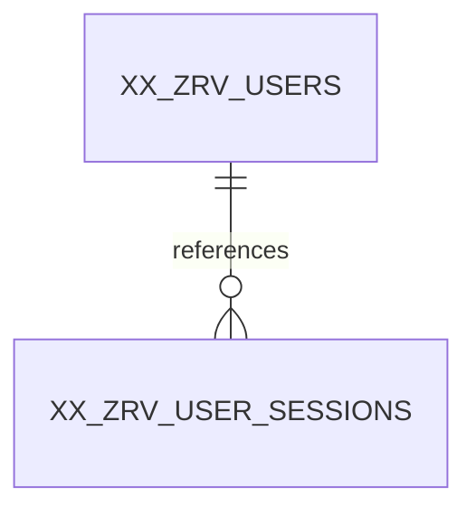

# XX_ZRV_USER_SESSIONS — Database Design & Security Reference
**Design status:** **APPROVED AND LOCKED** · **Sequence:** 09/11 · **Columns:** 13 · **Approval:** 17 October 2026 · **Document purpose:** technical preservation, not schema change.

> **Source status:** Table columns and approvals were reconciled against the locked 17-Oct-2026 RBAC discussions and the previously generated, unexecuted `Zamil_Revamp_RBAC_11_Tables_Oracle_ADW.sql` snapshot. Architecture document 01 and API document 02 were discoverable in the project Library; the full text of architecture documents 03–06 was **not available for independent byte-level verification in this run**. Shared standards cited below are corroborated by the RBAC discussion; any unverified detail is explicitly identified. No Oracle database was accessed.

## A. Overview and responsibility
**Business and technical purpose.** Stores the unique SHA-256 hash of each random session credential plus current session activity, absolute expiry, MFA assurance, revocation and restricted client metadata.
**Why it is necessary.** There would be no server-side revocation, per-device session enumeration or robust session lifetime management.
**When and where used.** Validated on every protected browser request and managed on login, logout, revoke-all and security changes.
**Boundary in the RBAC system.** Opaque server-managed authenticated sessions. This table participates in the approved 11-table centralized authorization design. It is not a source of Oracle Fusion employee profile attributes. Its responsibilities do not imply direct role or permission grants beyond the approved foreign-key model.

## B. Approved column catalog
| # | Column | Exact Oracle datatype | Nullability | Default / generation | Key / important validation | Representative value |
|---:|---|---|---|---|---|---|
| 1 | `SESSION_ID` | `NUMBER(19,0)` | NOT NULL | `GENERATED ALWAYS AS IDENTITY` | PK; NOT NULL / required; identity primary key | `5001` |
| 2 | `USER_ID` | `NUMBER(19,0)` | NOT NULL | `—` | FK; NOT NULL / required; verify corresponding FK where present | `105` |
| 3 | `SESSION_TOKEN_HASH` | `RAW(32)` | NOT NULL | `—` | —; NOT NULL / required; RAW(32), unique, one-way digest | `[32-BYTE SHA-256 DIGEST — REDACTED]` |
| 4 | `LAST_ACTIVITY_AT` | `TIMESTAMP(6) WITH TIME ZONE` | NOT NULL | `—` | —; NOT NULL / required | `2026-10-17T09:42:00+00:00` |
| 5 | `EXPIRES_AT` | `TIMESTAMP(6) WITH TIME ZONE` | NOT NULL | `—` | —; NOT NULL / required; UTC instant; lifecycle validity checked by backend | `2026-10-17T17:00:00+00:00` |
| 6 | `REVOKED_AT` | `TIMESTAMP(6) WITH TIME ZONE` | NULL allowed | `—` | —; UTC instant; lifecycle validity checked by backend | `NULL` |
| 7 | `MFA_VERIFIED_AT` | `TIMESTAMP(6) WITH TIME ZONE` | NULL allowed | `—` | —; Type/length/nullability plus table-specific business validation. | `2026-10-17T09:00:00+00:00` |
| 8 | `LOGIN_IP_ADDRESS` | `VARCHAR2(45 CHAR)` | NULL allowed | `—` | —; Type/length/nullability plus table-specific business validation. | `192.0.2.15` |
| 9 | `USER_AGENT` | `VARCHAR2(512 CHAR)` | NULL allowed | `—` | —; untrusted, sanitize for output | `Mozilla/5.0 ... Chrome/...` |
| 10 | `CREATED_AT` | `TIMESTAMP(6) WITH TIME ZONE` | NOT NULL | `(SYSTIMESTAMP AT TIME ZONE 'UTC')` | —; NOT NULL / required; UTC event timestamp | `2026-10-17T09:00:00+00:00` |
| 11 | `CREATED_BY` | `NUMBER(19,0)` | NOT NULL | `—` | FK; NOT NULL / required; verify corresponding FK where present | `105` |
| 12 | `UPDATED_AT` | `TIMESTAMP(6) WITH TIME ZONE` | NULL allowed | `—` | —; Type/length/nullability plus table-specific business validation. | `2026-10-17T09:42:00+00:00` |
| 13 | `UPDATED_BY` | `NUMBER(19,0)` | NULL allowed | `—` | FK; verify corresponding FK where present | `105` |

### Column-by-column semantics, population and mutability
**`SESSION_ID` — `NUMBER(19,0)`.** Internal session record identity; never use alone as a browser credential. **Population/change:** Generated on INSERT by Oracle; must never be rewritten or supplied by ordinary application clients. **Validation/security:** NOT NULL / required; identity primary key **Example:** `5001`.

**`USER_ID` — `NUMBER(19,0)`.** Foreign key to XX_ZRV_USERS.USER_ID identifying the user concerned with this opaque server-managed authenticated sessions record, not the Fusion employee master USER_ID. **Population/change:** Populated after authentication when a new session is issued; immutable association for the session lifetime. **Validation/security:** NOT NULL / required; verify corresponding FK where present **Example:** `105`.

**`SESSION_TOKEN_HASH` — `RAW(32)`.** SHA-256 digest RAW(32) of a random 256-bit opaque bearer token; indexed lookup, never store token plaintext. **Population/change:** Set once from a server-generated cryptographic token at creation; never replace with plaintext or expose via API. **Validation/security:** NOT NULL / required; RAW(32), unique, one-way digest **Example:** `[32-BYTE SHA-256 DIGEST — REDACTED]`.

**`LAST_ACTIVITY_AT` — `TIMESTAMP(6) WITH TIME ZONE`.** Last recorded authenticated activity UTC for sliding inactivity timeout enforcement. **Population/change:** Backend-managed security state; never writable by ordinary client input. Update atomically where concurrent requests could conflict. **Validation/security:** NOT NULL / required **Example:** `2026-10-17T09:42:00+00:00`.

**`EXPIRES_AT` — `TIMESTAMP(6) WITH TIME ZONE`.** Required absolute UTC expiry: a credential is invalid at or after this instant, even if unrevoked and otherwise valid. **Population/change:** Set to a mandatory absolute UTC deadline at issuance; must exceed CREATED_AT and cannot be bypassed by subsequent activity. **Validation/security:** NOT NULL / required; UTC instant; lifecycle validity checked by backend **Example:** `2026-10-17T17:00:00+00:00`.

**`REVOKED_AT` — `TIMESTAMP(6) WITH TIME ZONE`.** UTC event instant of explicit invalidation, distinct from natural expiration/consumption. **Population/change:** Initially NULL; set on explicit invalidation of the session or account-action token. The invalidated credential must never be accepted again. **Validation/security:** UTC instant; lifecycle validity checked by backend **Example:** `NULL`.

**`MFA_VERIFIED_AT` — `TIMESTAMP(6) WITH TIME ZONE`.** UTC instant MFA assurance completed for this particular session; not the TOTP enrollment timestamp. **Population/change:** Backend-managed security state; never writable by ordinary client input. Update atomically where concurrent requests could conflict. **Validation/security:** Type/length/nullability plus table-specific business validation. **Example:** `2026-10-17T09:00:00+00:00`.

**`LOGIN_IP_ADDRESS` — `VARCHAR2(45 CHAR)`.** Observed client network address on session creation; derived only through trusted proxy handling and not used as sole identity. **Population/change:** Set on creation; any permitted change follows feature validation, RBAC authorization and audit rules. **Validation/security:** Type/length/nullability plus table-specific business validation. **Example:** `192.0.2.15`.

**`USER_AGENT` — `VARCHAR2(512 CHAR)`.** Untrusted HTTP client metadata used for device/session visibility and investigation; escape before display. **Population/change:** Set on creation; any permitted change follows feature validation, RBAC authorization and audit rules. **Validation/security:** untrusted, sanitize for output **Example:** `Mozilla/5.0 ... Chrome/...`.

**`CREATED_AT` — `TIMESTAMP(6) WITH TIME ZONE`.** UTC timestamp of row creation, with database default SYSTIMESTAMP AT TIME ZONE UTC. In the audit-log table specifically, it represents event recording time. **Population/change:** Set by Oracle UTC default if omitted; creation value must remain unchanged. **Validation/security:** NOT NULL / required; UTC event timestamp **Example:** `2026-10-17T09:00:00+00:00`.

**`CREATED_BY` — `NUMBER(19,0)`.** Mandatory authenticated user establishing the session; SQL CHECK further enforces CREATED_BY = USER_ID. **Population/change:** Set from validated actor context at INSERT; do not rewrite later. **Validation/security:** NOT NULL / required; verify corresponding FK where present **Example:** `105`.

**`UPDATED_AT` — `TIMESTAMP(6) WITH TIME ZONE`.** UTC timestamp of last permitted record modification, nullable and initially NULL. The RBAC audit-log table is a special case where it must always remain NULL. **Population/change:** Initially NULL; set to the UTC change instant only when a real modification succeeds. **Validation/security:** Type/length/nullability plus table-specific business validation. **Example:** `2026-10-17T09:42:00+00:00`.

**`UPDATED_BY` — `NUMBER(19,0)`.** Authenticated account responsible for last permitted modification when attributable; nullable. The RBAC audit-log table is a special case where it must always remain NULL. **Population/change:** Initially NULL; set to validated actor only on permitted modification. **Validation/security:** verify corresponding FK where present **Example:** `105`.

## C. Keys, constraints, validation and indexes
The following constraint names and rules are transcribed from the previously prepared, **unexecuted** DDL snapshot. Database constraints protect row integrity; eligibility and authorization checks remain backend responsibilities.

| Constraint | Approved rule / purpose | Failure prevented |
|---|---|---|
| `PK_ZRV_SESS` | Establishes immutable row identity; prevents ambiguous joins and records. `PRIMARY KEY (SESSION_ID)` | Without it, dependent FKs and precise event/row references would fail. |
| `UQ_ZRV_SESS_TOKEN` | Prohibits duplicate keys or assignment pairs, including previously deactivated rows. `UNIQUE (SESSION_TOKEN_HASH)` | Without it, repeated grants, inconsistent logins or duplicate policy decisions could occur. |
| `CK_ZRV_SESS_EXP` | Ensures the absolute expiration is later than record creation. `CHECK (EXPIRES_AT > CREATED_AT)` | Without it, unusable or ambiguous session/recovery lifetimes could be persisted. |
| `CK_ZRV_SESS_CBY` | Enforces cross-column actor, target, or immutable-row consistency. `CHECK (CREATED_BY = USER_ID)` | Without it, security events or sessions could be incorrectly attributed or modified. |
| `FK_ZRV_SESS_USER` | Guarantees an existing referenced parent at insertion/update; ordinary deletion of referenced parent is restricted. `FOREIGN KEY (USER_ID) REFERENCES XX_ZRV_USERS (USER_ID)` | Without it, orphan memberships, permissions or unattributable audit references would accumulate. |
| `FK_ZRV_SESS_CBY` | Guarantees an existing referenced parent at insertion/update; ordinary deletion of referenced parent is restricted. `FOREIGN KEY (CREATED_BY) REFERENCES XX_ZRV_USERS (USER_ID)` | Without it, orphan memberships, permissions or unattributable audit references would accumulate. |
| `FK_ZRV_SESS_UBY` | Guarantees an existing referenced parent at insertion/update; ordinary deletion of referenced parent is restricted. `FOREIGN KEY (UPDATED_BY) REFERENCES XX_ZRV_USERS (USER_ID)` | Without it, orphan memberships, permissions or unattributable audit references would accumulate. |

**NOT NULL and defaults.** `NOT NULL` requirements are listed per column above. Oracle-generated identity IDs are not user-supplied. Explicit non-identity defaults in this table: `CREATED_AT` = `(SYSTIMESTAMP AT TIME ZONE 'UTC')`. SQL CHECK constraints do not replace Joi validation or safe backend state transitions.

**Indexes.** Oracle normally supplies supporting indexes for PK/UNIQUE constraints; do not create duplicate equivalents. The separately approved/indexed reverse lookups are:
```sql
CREATE INDEX IX_ZRV_SESS_USER_REV ON XX_ZRV_USER_SESSIONS (USER_ID, REVOKED_AT);
```

**Constraint enforcement boundary.** A FK proves a parent row exists, not that the parent remains active; an expiry CHECK cannot consult the continuously changing clock; and a row CHECK cannot evaluate effective permissions across many tables. Those requirements belong in transaction-aware Node.js services and middleware.

## D. Relationships and referential integrity
**Parent tables:** [XX_ZRV_USERS](XX_ZRV_USERS.md).
**Direct RBAC children:** None in the approved schema; other components can still query the table logically.

| FK constraint | Child column | Parent key | Relationship meaning |
|---|---|---|---|
| `FK_ZRV_SESS_USER` | `XX_ZRV_USER_SESSIONS.USER_ID` | `XX_ZRV_USERS.USER_ID` | Many XX_ZRV_USER_SESSIONS records can reference one parent record; nullability follows the column definition. |
| `FK_ZRV_SESS_CBY` | `XX_ZRV_USER_SESSIONS.CREATED_BY` | `XX_ZRV_USERS.USER_ID` | Many XX_ZRV_USER_SESSIONS records can reference one parent record; nullability follows the column definition. |
| `FK_ZRV_SESS_UBY` | `XX_ZRV_USER_SESSIONS.UPDATED_BY` | `XX_ZRV_USERS.USER_ID` | Many XX_ZRV_USER_SESSIONS records can reference one parent record; nullability follows the column definition. |

**Direct parent relationship sketch** (conceptual cardinalities; nullable audit actor FKs may be absent):


**Insertion/deletion rules:** Create core parents before dependent relationships. Oracle FKs prevent inserting nonexistent parent keys and ordinarily prevent deleting parents that still have referencing rows. Approved administration favors deactivation, revocation or expiration over hard deletion; never enable cascade deletion of access/audit history by convenience. Join through approved numeric IDs for RBAC and through verified employee number for Fusion profile context.

## E. Operational usage and realistic example
**Create:** After required password/MFA verification, generate a fresh 256-bit opaque token and persist its SHA-256 digest (never token plaintext).
**Read:** Backend hashes cookie-provided token, looks up token hash and verifies idle/absolute expiry and account/authorization state.
**Update:** Throttled LAST_ACTIVITY_AT updates, session MFA state where applicable, and explicit REVOKED_AT are controlled by the backend.
**Deactivate/revoke/expire:** Revoke on logout, logout-all, account compromise or appropriate MFA/credential change; expiry is derived without mandatory cleanup writes.

**Illustrative record** (not real employee or operational data; credential secrets always redacted):
| Column | Sample value |
|---|---|
| `SESSION_ID` | `5001` |
| `USER_ID` | `105` |
| `SESSION_TOKEN_HASH` | `[32-BYTE SHA-256 DIGEST — REDACTED]` |
| `LAST_ACTIVITY_AT` | `2026-10-17T09:42:00+00:00` |
| `EXPIRES_AT` | `2026-10-17T17:00:00+00:00` |
| `REVOKED_AT` | `NULL` |
| `MFA_VERIFIED_AT` | `2026-10-17T09:00:00+00:00` |
| `LOGIN_IP_ADDRESS` | `192.0.2.15` |
| `USER_AGENT` | `Mozilla/5.0 ... Chrome/...` |
| `CREATED_AT` | `2026-10-17T09:00:00+00:00` |
| `CREATED_BY` | `105` |
| `UPDATED_AT` | `2026-10-17T09:42:00+00:00` |
| `UPDATED_BY` | `105` |

**How to interpret the example.** This is one conceptual record in the Zamil-Revamp RBAC model, linked only to demonstrative other records (for example local user 105, production role 20, resource 101). A `NULL` sample is deliberately an allowed absence, not proof that the field is always NULL. Identifiers, employee numbers, times and client IP addresses are illustrative.

## F. Complete record lifecycle
1. **Pre-create:** Validate relevant parents, eligibility, required field types and authorization before issuing database work. After required password/MFA verification, generate a fresh 256-bit opaque token and persist its SHA-256 digest (never token plaintext).
2. **Create:** Use a bind-variable INSERT omitting generated IDs and allowing the UTC default; populate verified actor and required business fields. Insert any critical security audit event in the same transaction.
3. **Read/use:** Backend hashes cookie-provided token, looks up token hash and verifies idle/absolute expiry and account/authorization state.
4. **Modify:** Throttled LAST_ACTIVITY_AT updates, session MFA state where applicable, and explicit REVOKED_AT are controlled by the backend. Enforce actual state transitions and audit actor metadata.
5. **End effective life:** Revoke on logout, logout-all, account compromise or appropriate MFA/credential change; expiry is derived without mandatory cleanup writes.
6. **Historical/retention treatment:** Preserve referenced security history under the approved non-cascade approach; retention duration, archival implementation and privileged purge access are unresolved policy decisions unless stated otherwise below.

## G. Security, access control and abuse prevention
**Approved security and business invariants:**
- SESSION_TOKEN_HASH RAW(32) UNIQUE; no plain session tokens or permission snapshots in Oracle.
- CREATED_BY = USER_ID for an authenticated session.
- EXPIRES_AT must be after CREATED_AT; required inactivity cutoff compares LAST_ACTIVITY_AT to configured idle timeout.
- MFA_VERIFIED_AT is session-specific; one TOTP enrollment in USERS can authenticate multiple device sessions.
- Secure HttpOnly cookie, HTTPS, SameSite/CSRF controls and backend verification are mandatory.

**Database vs backend responsibilities.** Oracle enforces identity, uniqueness, FK references, supported CHECK conditions and exact typed values. The Node.js service must enforce the right administrator authority, current account/Fusion employee eligibility, active modules/resources/permissions, direct ALLOW/DENY precedence, mandatory MFA, record-level/organizational policy, rate limiting, secure time windows and cross-row concurrency. React may render allowed actions but is never the authoritative policy enforcement point.
**Abuse cases:** protect against unauthorized self-assignment, stale access after revocation, tampered UI requests, forged identities, insecure logging and race conditions. Use parameterized SQL and least-privilege Oracle runtime grants. Password, TOTP and bearer-token values must never appear in logs or error details.

## H. Audit fields and timezone conventions
The approved shared standard uses **UTC exact event instants**, persisted as `TIMESTAMP(6) WITH TIME ZONE`, and presentation in **Asia/Riyadh** for Saudi users. The India development workstation timezone must not change stored instants. No event timestamp here is a date-only Oracle DATE business value.

| Field | Population rule | Nullability / lifecycle |
|---|---|---|
| `CREATED_AT` | Set by Oracle UTC default if omitted; creation value must remain unchanged. | NOT NULL; UTC default. |
| `CREATED_BY` | Set from validated actor context at INSERT; do not rewrite later. | NOT NULL; no default. |
| `UPDATED_AT` | Initially NULL; set to the UTC change instant only when a real modification succeeds. | NULL permitted; no default. |
| `UPDATED_BY` | Initially NULL; set to validated actor only on permitted modification. | NULL permitted; no default. |
**Session-specific audit exception:** `CREATED_BY` is mandatory and must equal the authenticated `USER_ID`; the user-agent/IP metadata are untrusted diagnostic hints, never a substitute for session credentials.

## I. Locked decisions, rejected alternatives, and unresolved items
### Approved and locked — do not change without explicit authorization
- SESSION_TOKEN_HASH RAW(32) UNIQUE; no plain session tokens or permission snapshots in Oracle.
- CREATED_BY = USER_ID for an authenticated session.
- EXPIRES_AT must be after CREATED_AT; required inactivity cutoff compares LAST_ACTIVITY_AT to configured idle timeout.
- MFA_VERIFIED_AT is session-specific; one TOTP enrollment in USERS can authenticate multiple device sessions.
- Secure HttpOnly cookie, HTTPS, SameSite/CSRF controls and backend verification are mandatory.

### Discussed and explicitly excluded from this table
- SESSION_STATUS/IS_ACTIVE (derived from expiry/revocation).
- SESSION_TOKEN plaintext, REFRESH_TOKEN.
- ROLE_ID, PERMISSIONS_JSON (would become stale).
- MFA secret/password hash (stored in USERS).
- LOGOUT_AT (REVOKED_AT is explicit invalidation).

### Not Confirmed / Requires Clarification / Not Yet Decided
- **Open item:** Exact idle and absolute timeout duration by user risk/role: Not Yet Decided.
- **Open item:** Frequency policy for LAST_ACTIVITY_AT and whether strong reauthentication is required for particular sensitive actions: Not Yet Decided.
- **Open item:** Retention of expired sessions and cookie name/domain policy: Not Yet Decided.

### Decision rationale and trade-off
The table is intentionally restricted to **opaque server-managed authenticated sessions**. Adding the rejected fields would either duplicate normalized RBAC/Fusion facts, create conflicting sources of truth, or couple access controls to presentation or transport details. The compact design allows controlled expansion **only through a separately approved design change**. The present document records approval history; recommendations or open items are not retroactively approved.

## J. Node.js / Express / React / Oracle integration
**Expected service behavior.** Validated on every protected browser request and managed on login, logout, revoke-all and security changes. The owning feature service verifies policy and transactions; its repository performs bounded Oracle SQL using binds and shared pooled connections. Controllers validate request contracts using Joi and return sanitized standardized responses. Auth/session and resource/action checks belong in centralized middleware plus domain-level business services. **No API URL is defined or approved by this document.**
**Typical repository operations.** After required password/MFA verification, generate a fresh 256-bit opaque token and persist its SHA-256 digest (never token plaintext). Backend hashes cookie-provided token, looks up token hash and verifies idle/absolute expiry and account/authorization state. Throttled LAST_ACTIVITY_AT updates, session MFA state where applicable, and explicit REVOKED_AT are controlled by the backend.
**Transaction responsibility.** Services own one Oracle connection per transaction and commit related security state/audit inserts together when success must be atomic. For failed attempts, record an independent audit event rather than losing it to a business rollback. Never infer external Fusion integration atomicity from an Oracle local transaction.
**React responsibilities.** Consume safe projected account/permission metadata only, never hash material, shared secrets, session bearer tokens or privileged raw audit details. Components display roles/permissions for usability; the backend repeats every mandatory check.
**Error classes to test.** Invalid input (400-style validation), missing parent/not found, duplicate unique key/conflict, inactive or ineligible account, unauthorized action (403), expired/revoked credential, concurrency conflict, Oracle transaction failure and audit-write failure. Final status codes and route contracts remain feature-specific and **not approved here**.

## K. Edge cases and expected handling
- **Case:** Duplicate token hash rejected; session ID alone cannot authenticate. **Expected:** Reject unsafe state, preserve referenced rows, report a safe error and create a security event where required.
- **Case:** Logout or revoke-all denies token on next request across processes. **Expected:** Reject unsafe state, preserve referenced rows, report a safe error and create a security event where required.
- **Case:** Idle timeout and absolute expiration independently deny access. **Expected:** Reject unsafe state, preserve referenced rows, report a safe error and create a security event where required.
- **Case:** Active session does not retain revoked permissions or access for disabled employee. **Expected:** Reject unsafe state, preserve referenced rows, report a safe error and create a security event where required.
- **Case:** MFA-required fully privileged session not issued before required MFA completion. **Expected:** Reject unsafe state, preserve referenced rows, report a safe error and create a security event where required.

**Concurrency:** Where multiple administrators or authentication requests act simultaneously, uniqueness and Oracle transactions are the last line of integrity defense; service-level guards must re-check current state while holding appropriate locks or implementing safe atomic updates. **Not Confirmed:** the final distributed cache invalidation and retry strategy.

## L. Implementation checklist and verification guidance
**Dependency and creation-order guidance:** `XX_ZRV_USERS` first (self-reference permitted), then ROLES and APP_MODULES, RESOURCES, PERMISSIONS, USER_ROLES, ROLE_PERMISSIONS, USER_PERMISSION_OVERRIDES, USER_SESSIONS, ACCOUNT_ACTION_TOKENS, RBAC_AUDIT_LOGS. Existing Fusion master is external, not created here. This order follows the previously produced SQL script; no runtime DDL is executed by these documents.

**Database verification (planned, not executed):** inspect USER_TAB_COLUMNS, USER_CONSTRAINTS, USER_CONS_COLUMNS and USER_INDEXES for exact datatypes/defaults/nullable flags, FK parent names and checks; test required/invalid duplicate inserts in nonproduction and verify error outcomes. Confirm data dictionary and Oracle version compatibility before any deployment.

**Specific acceptance tests (planned, not executed):
- [ ] Duplicate token hash rejected; session ID alone cannot authenticate.
- [ ] Logout or revoke-all denies token on next request across processes.
- [ ] Idle timeout and absolute expiration independently deny access.
- [ ] Active session does not retain revoked permissions or access for disabled employee.
- [ ] MFA-required fully privileged session not issued before required MFA completion.

**Cross-layer verification (planned, not executed):** exercise normal and failure workflows using Node.js native test runner and Supertest, plus isolated Oracle test data. Verify backend denial even when React controls are manipulated; check JSON/log redaction, role-cache freshness, safe ID precision, and precise UTC/KSA conversions. Record evidence of tests actually executed and never call planned checks "passed".

**New recommendations, not approvals:** validate physical Oracle CHECK/DEFAULT compilation on the target ADW before running in production, secure least-privilege runtime grants, size operational log retention after actual workload measurement, and document an approved rollback/reconciliation plan. None modifies a locked field.

## M. CREATE TABLE statement — documented existing DDL snapshot
> **IMPORTANT:** The statement below is reproduced verbatim from the previously generated SQL file for technical reference. It has **not been executed or compiled against your Oracle instance**, and its inclusion is not approval to change the schema. Standalone CREATE TABLE may depend on parent tables being present; supporting indexes and append-only trigger, where applicable, follow separately.
```sql
CREATE TABLE XX_ZRV_USER_SESSIONS (
    SESSION_ID                  NUMBER(19,0) GENERATED ALWAYS AS IDENTITY,
    USER_ID                     NUMBER(19,0) NOT NULL,
    SESSION_TOKEN_HASH          RAW(32) NOT NULL,
    LAST_ACTIVITY_AT            TIMESTAMP(6) WITH TIME ZONE NOT NULL,
    EXPIRES_AT                  TIMESTAMP(6) WITH TIME ZONE NOT NULL,
    REVOKED_AT                  TIMESTAMP(6) WITH TIME ZONE,
    MFA_VERIFIED_AT             TIMESTAMP(6) WITH TIME ZONE,
    LOGIN_IP_ADDRESS            VARCHAR2(45 CHAR),
    USER_AGENT                  VARCHAR2(512 CHAR),
    CREATED_AT                  TIMESTAMP(6) WITH TIME ZONE DEFAULT (SYSTIMESTAMP AT TIME ZONE 'UTC') NOT NULL,
    CREATED_BY                  NUMBER(19,0) NOT NULL,
    UPDATED_AT                  TIMESTAMP(6) WITH TIME ZONE,
    UPDATED_BY                  NUMBER(19,0),
    CONSTRAINT PK_ZRV_SESS PRIMARY KEY (SESSION_ID),
    CONSTRAINT UQ_ZRV_SESS_TOKEN UNIQUE (SESSION_TOKEN_HASH),
    CONSTRAINT CK_ZRV_SESS_EXP CHECK (EXPIRES_AT > CREATED_AT),
    CONSTRAINT CK_ZRV_SESS_CBY CHECK (CREATED_BY = USER_ID),
    CONSTRAINT FK_ZRV_SESS_USER FOREIGN KEY (USER_ID) REFERENCES XX_ZRV_USERS (USER_ID),
    CONSTRAINT FK_ZRV_SESS_CBY FOREIGN KEY (CREATED_BY) REFERENCES XX_ZRV_USERS (USER_ID),
    CONSTRAINT FK_ZRV_SESS_UBY FOREIGN KEY (UPDATED_BY) REFERENCES XX_ZRV_USERS (USER_ID)
);
```

### Supporting indexes — separately approved DDL snapshot
```sql
CREATE INDEX IX_ZRV_SESS_USER_REV ON XX_ZRV_USER_SESSIONS (USER_ID, REVOKED_AT);
```

## N. Related reading and traceability
- Other directly related finalized table documents: [XX_ZRV_USERS](XX_ZRV_USERS.md).
- [README.md](README.md) — cross-table index, decision statuses, outstanding confirmation items and complete system-level authorization flow.
- Approved backend architecture references (project `server/docs/`): `01-SYSTEM_ARCHITECTURE.md`, `02-API_DEVELOPMENT_STANDARDS.md`, `03-ORACLE_DATABASE_ARCHITECTURE.md`, `04-AUTHENTICATION_RBAC_SECURITY.md`, `05-CONFIGURATION_OPERATIONS.md`, `06-ARCHITECTURE_DECISIONS_GUIDELINES.md`. Only architecture 01/02 were retrievable by file search in this run; explicit RBAC approvals supersede their earlier "tables pending" wording.
- Oracle DDL reference: previously generated `Zamil_Revamp_RBAC_11_Tables_Oracle_ADW.sql` (unexecuted static snapshot).
- Documentation status: **Design APPROVED AND LOCKED; database execution and full integration verification NOT PERFORMED.**
