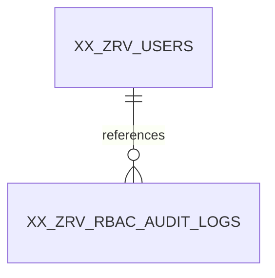

# XX_ZRV_RBAC_AUDIT_LOGS — Database Design & Security Reference
**Design status:** **APPROVED AND LOCKED** · **Sequence:** 11/11 · **Columns:** 16 · **Approval:** 17 October 2026 · **Document purpose:** technical preservation, not schema change.

> **Source status:** Table columns and approvals were reconciled against the locked 17-Oct-2026 RBAC discussions and the previously generated, unexecuted `Zamil_Revamp_RBAC_11_Tables_Oracle_ADW.sql` snapshot. Architecture document 01 and API document 02 were discoverable in the project Library; the full text of architecture documents 03–06 was **not available for independent byte-level verification in this run**. Shared standards cited below are corroborated by the RBAC discussion; any unverified detail is explicitly identified. No Oracle database was accessed.

## A. Overview and responsibility
**Business and technical purpose.** Captures security-relevant authentication, MFA, account, RBAC administration, session, recovery and denied-action events with actor, subject, target, result and sanitized context.
**Why it is necessary.** There would be no durable evidence of who changed authority, whom it affected, when it happened or whether access was denied.
**When and where used.** Written for sensitive account/RBAC mutations and security failures, and read only by authorized investigators/compliance functions.
**Boundary in the RBAC system.** Append-only security audit trail. This table participates in the approved 11-table centralized authorization design. It is not a source of Oracle Fusion employee profile attributes. Its responsibilities do not imply direct role or permission grants beyond the approved foreign-key model.

## B. Approved column catalog
| # | Column | Exact Oracle datatype | Nullability | Default / generation | Key / important validation | Representative value |
|---:|---|---|---|---|---|---|
| 1 | `AUDIT_LOG_ID` | `NUMBER(19,0)` | NOT NULL | `GENERATED ALWAYS AS IDENTITY` | PK; NOT NULL / required; identity primary key | `100001` |
| 2 | `EVENT_CODE` | `VARCHAR2(80 CHAR)` | NOT NULL | `—` | —; NOT NULL / required; uppercase, trimmed, A–Z / 0–9 / underscore, starts with a letter | `RBAC_ROLE_ASSIGNED` |
| 3 | `EVENT_OUTCOME` | `VARCHAR2(12 CHAR)` | NOT NULL | `—` | —; NOT NULL / required; SUCCESS/FAILURE/DENIED | `SUCCESS` |
| 4 | `ACTOR_TYPE` | `VARCHAR2(15 CHAR)` | NOT NULL | `—` | —; NOT NULL / required; USER/SYSTEM/ANONYMOUS | `USER` |
| 5 | `SUBJECT_USER_ID` | `NUMBER(19,0)` | NULL allowed | `—` | FK; verify corresponding FK where present | `105` |
| 6 | `TARGET_TYPE` | `VARCHAR2(40 CHAR)` | NULL allowed | `—` | —; Type/length/nullability plus table-specific business validation. | `USER_ROLE` |
| 7 | `TARGET_RECORD_ID` | `NUMBER(19,0)` | NULL allowed | `—` | —; Type/length/nullability plus table-specific business validation. | `1001` |
| 8 | `REASON_CODE` | `VARCHAR2(60 CHAR)` | NULL allowed | `—` | —; Type/length/nullability plus table-specific business validation. | `NULL` |
| 9 | `CORRELATION_ID` | `VARCHAR2(64 CHAR)` | NULL allowed | `—` | —; Type/length/nullability plus table-specific business validation. | `req-8f2d61a4` |
| 10 | `CLIENT_IP_ADDRESS` | `VARCHAR2(45 CHAR)` | NULL allowed | `—` | —; Type/length/nullability plus table-specific business validation. | `192.0.2.15` |
| 11 | `USER_AGENT` | `VARCHAR2(512 CHAR)` | NULL allowed | `—` | —; untrusted, sanitize for output | `Mozilla/5.0 ... Chrome/...` |
| 12 | `EVENT_DETAILS` | `CLOB` | NULL allowed | `—` | —; valid JSON when present, sanitized | `{"roleCode":"PRODUCTION_SUPERVISOR","previousState":"INACTIVE","newState":"ACTIVE"}` |
| 13 | `CREATED_AT` | `TIMESTAMP(6) WITH TIME ZONE` | NOT NULL | `(SYSTIMESTAMP AT TIME ZONE 'UTC')` | —; NOT NULL / required; UTC event timestamp | `2026-10-17T11:00:00+00:00` |
| 14 | `CREATED_BY` | `NUMBER(19,0)` | NULL allowed | `—` | FK; verify corresponding FK where present | `1` |
| 15 | `UPDATED_AT` | `TIMESTAMP(6) WITH TIME ZONE` | NULL allowed | `—` | —; Type/length/nullability plus table-specific business validation. | `NULL` |
| 16 | `UPDATED_BY` | `NUMBER(19,0)` | NULL allowed | `—` | FK; verify corresponding FK where present | `NULL` |

### Column-by-column semantics, population and mutability
**`AUDIT_LOG_ID` — `NUMBER(19,0)`.** Immutable sequence-generated identity of an append-only security event. **Population/change:** Generated on INSERT by Oracle; must never be rewritten or supplied by ordinary application clients. **Validation/security:** NOT NULL / required; identity primary key **Example:** `100001`.

**`EVENT_CODE` — `VARCHAR2(80 CHAR)`.** Uppercase controlled name for the security event, e.g. RBAC_ROLE_ASSIGNED. **Population/change:** Populated once at INSERT, then immutable; never UPDATE the audit row. **Validation/security:** NOT NULL / required; uppercase, trimmed, A–Z / 0–9 / underscore, starts with a letter **Example:** `RBAC_ROLE_ASSIGNED`.

**`EVENT_OUTCOME` — `VARCHAR2(12 CHAR)`.** Required SUCCESS, FAILURE or DENIED result; independent of explanatory REASON_CODE. **Population/change:** Populated once at INSERT, then immutable; never UPDATE the audit row. **Validation/security:** NOT NULL / required; SUCCESS/FAILURE/DENIED **Example:** `SUCCESS`.

**`ACTOR_TYPE` — `VARCHAR2(15 CHAR)`.** USER (authenticated), SYSTEM (automated) or ANONYMOUS (unverified). Controls whether CREATED_BY may be populated. **Population/change:** Populated once at INSERT, then immutable; never UPDATE the audit row. **Validation/security:** NOT NULL / required; USER/SYSTEM/ANONYMOUS **Example:** `USER`.

**`SUBJECT_USER_ID` — `NUMBER(19,0)`.** Affected user account (optional FK); must not be confused with authenticated actor. **Population/change:** Populated once at INSERT, then immutable; never UPDATE the audit row. **Validation/security:** verify corresponding FK where present **Example:** `105`.

**`TARGET_TYPE` — `VARCHAR2(40 CHAR)`.** Controlled uppercase category of affected RBAC/security record; paired with TARGET_RECORD_ID. **Population/change:** Populated once at INSERT, then immutable; never UPDATE the audit row. **Validation/security:** Type/length/nullability plus table-specific business validation. **Example:** `USER_ROLE`.

**`TARGET_RECORD_ID` — `NUMBER(19,0)`.** ID of affected object, meaningful with TARGET_TYPE; polymorphic audit reference, not conventional FK. **Population/change:** Populated once at INSERT, then immutable; never UPDATE the audit row. **Validation/security:** Type/length/nullability plus table-specific business validation. **Example:** `1001`.

**`REASON_CODE` — `VARCHAR2(60 CHAR)`.** Controlled reason identifier e.g. INSUFFICIENT_PERMISSION; do not expose sensitive internal details publicly. **Population/change:** Populated once at INSERT, then immutable; never UPDATE the audit row. **Validation/security:** Type/length/nullability plus table-specific business validation. **Example:** `NULL`.

**`CORRELATION_ID` — `VARCHAR2(64 CHAR)`.** Links security event to related Node.js request/application logs; never a bearer credential. **Population/change:** Populated once at INSERT, then immutable; never UPDATE the audit row. **Validation/security:** Type/length/nullability plus table-specific business validation. **Example:** `req-8f2d61a4`.

**`CLIENT_IP_ADDRESS` — `VARCHAR2(45 CHAR)`.** Client IP from trusted network context for security investigation; no sole identity reliance. **Population/change:** Populated once at INSERT, then immutable; never UPDATE the audit row. **Validation/security:** Type/length/nullability plus table-specific business validation. **Example:** `192.0.2.15`.

**`USER_AGENT` — `VARCHAR2(512 CHAR)`.** Untrusted HTTP client metadata used for device/session visibility and investigation; escape before display. **Population/change:** Populated once at INSERT, then immutable; never UPDATE the audit row. **Validation/security:** untrusted, sanitize for output **Example:** `Mozilla/5.0 ... Chrome/...`.

**`EVENT_DETAILS` — `CLOB`.** Nullable sanitized JSON document as Oracle CLOB; explicitly exclude passwords, token values/hashes, TOTP and Fusion sensitive HR data. **Population/change:** Populated once at INSERT, then immutable; never UPDATE the audit row. **Validation/security:** valid JSON when present, sanitized **Example:** `{"roleCode":"PRODUCTION_SUPERVISOR","previousState":"INACTIVE","newState":"ACTIVE"}`.

**`CREATED_AT` — `TIMESTAMP(6) WITH TIME ZONE`.** Exact UTC audit event recording instant; append-only, never mutable. **Population/change:** Populated once at INSERT, then immutable; never UPDATE the audit row. **Validation/security:** NOT NULL / required; UTC event timestamp **Example:** `2026-10-17T11:00:00+00:00`.

**`CREATED_BY` — `NUMBER(19,0)`.** Authenticated event actor when ACTOR_TYPE=USER, otherwise NULL. Distinct from SUBJECT_USER_ID (affected account). **Population/change:** Populated once at INSERT, then immutable; never UPDATE the audit row. **Validation/security:** verify corresponding FK where present **Example:** `1`.

**`UPDATED_AT` — `TIMESTAMP(6) WITH TIME ZONE`.** Included only for the cross-table four-column audit convention; explicit CHECK forces permanent NULL and the audit row must never be edited. **Population/change:** Populated once at INSERT, then immutable; never UPDATE the audit row. **Validation/security:** Type/length/nullability plus table-specific business validation. **Example:** `NULL`.

**`UPDATED_BY` — `NUMBER(19,0)`.** Included only for the cross-table four-column audit convention; explicit CHECK forces permanent NULL and the audit row must never be edited. **Population/change:** Populated once at INSERT, then immutable; never UPDATE the audit row. **Validation/security:** verify corresponding FK where present **Example:** `NULL`.

## C. Keys, constraints, validation and indexes
The following constraint names and rules are transcribed from the previously prepared, **unexecuted** DDL snapshot. Database constraints protect row integrity; eligibility and authorization checks remain backend responsibilities.

| Constraint | Approved rule / purpose | Failure prevented |
|---|---|---|
| `PK_ZRV_AUD` | Establishes immutable row identity; prevents ambiguous joins and records. `PRIMARY KEY (AUDIT_LOG_ID)` | Without it, dependent FKs and precise event/row references would fail. |
| `CK_ZRV_AUD_EVENT` | Enforces canonical, stable machine-readable codes. `CHECK ( EVENT_CODE = TRIM(EVENT_CODE) AND REGEXP_LIKE(EVENT_CODE, '^[A-Z][A-Z0-9_]*$', 'c') )` | Without it, inconsistent casing or spacing could make authorization lookups disagree. |
| `CK_ZRV_AUD_OUTCOME` | Restricts the column to agreed lifecycle or decision values. `CHECK (EVENT_OUTCOME IN ('SUCCESS', 'FAILURE', 'DENIED'))` | Without it, the backend could receive unknown states and make unsafe policy assumptions. |
| `CK_ZRV_AUD_ACTOR` | Enforces a reviewed data-consistency invariant in the approved DDL. `CHECK (ACTOR_TYPE IN ('USER', 'SYSTEM', 'ANONYMOUS'))` | Without it, invalid or internally inconsistent values may enter the data model. |
| `CK_ZRV_AUD_ACTOR_ID` | Enforces cross-column actor, target, or immutable-row consistency. `CHECK ( (ACTOR_TYPE = 'USER' AND CREATED_BY IS NOT NULL) OR (ACTOR_TYPE IN ('SYSTEM','ANONYMOUS') AND CREATED_BY IS NULL) )` | Without it, security events or sessions could be incorrectly attributed or modified. |
| `CK_ZRV_AUD_TARGET` | Enforces cross-column actor, target, or immutable-row consistency. `CHECK ( (TARGET_TYPE IS NULL AND TARGET_RECORD_ID IS NULL) OR (TARGET_TYPE IS NOT NULL AND TARGET_RECORD_ID IS NOT NULL) )` | Without it, security events or sessions could be incorrectly attributed or modified. |
| `CK_ZRV_AUD_TARGET_CODE` | Enforces canonical, stable machine-readable codes. `CHECK ( TARGET_TYPE IS NULL OR ( TARGET_TYPE = TRIM(TARGET_TYPE) AND REGEXP_LIKE(TARGET_TYPE, '^[A-Z][A-Z0-9_]*$', 'c') ) )` | Without it, inconsistent casing or spacing could make authorization lookups disagree. |
| `CK_ZRV_AUD_DETAILS` | Validates the JSON structure of optional event context. `CHECK (EVENT_DETAILS IS JSON)` | Without it, malformed audit context could break investigation tools and security parsing. |
| `CK_ZRV_AUD_IMMUT` | Enforces cross-column actor, target, or immutable-row consistency. `CHECK (UPDATED_AT IS NULL AND UPDATED_BY IS NULL)` | Without it, security events or sessions could be incorrectly attributed or modified. |
| `FK_ZRV_AUD_SUBJ` | Guarantees an existing referenced parent at insertion/update; ordinary deletion of referenced parent is restricted. `FOREIGN KEY (SUBJECT_USER_ID) REFERENCES XX_ZRV_USERS (USER_ID)` | Without it, orphan memberships, permissions or unattributable audit references would accumulate. |
| `FK_ZRV_AUD_CBY` | Guarantees an existing referenced parent at insertion/update; ordinary deletion of referenced parent is restricted. `FOREIGN KEY (CREATED_BY) REFERENCES XX_ZRV_USERS (USER_ID)` | Without it, orphan memberships, permissions or unattributable audit references would accumulate. |
| `FK_ZRV_AUD_UBY` | Guarantees an existing referenced parent at insertion/update; ordinary deletion of referenced parent is restricted. `FOREIGN KEY (UPDATED_BY) REFERENCES XX_ZRV_USERS (USER_ID)` | Without it, orphan memberships, permissions or unattributable audit references would accumulate. |

**NOT NULL and defaults.** `NOT NULL` requirements are listed per column above. Oracle-generated identity IDs are not user-supplied. Explicit non-identity defaults in this table: `CREATED_AT` = `(SYSTIMESTAMP AT TIME ZONE 'UTC')`. SQL CHECK constraints do not replace Joi validation or safe backend state transitions.

**Indexes.** Oracle normally supplies supporting indexes for PK/UNIQUE constraints; do not create duplicate equivalents. The separately approved/indexed reverse lookups are:
```sql
CREATE INDEX IX_ZRV_AUD_DATE ON XX_ZRV_RBAC_AUDIT_LOGS (CREATED_AT);
CREATE INDEX IX_ZRV_AUD_ACTOR_DATE ON XX_ZRV_RBAC_AUDIT_LOGS (CREATED_BY, CREATED_AT);
CREATE INDEX IX_ZRV_AUD_SUBJ_DATE ON XX_ZRV_RBAC_AUDIT_LOGS (SUBJECT_USER_ID, CREATED_AT);
CREATE INDEX IX_ZRV_AUD_TGT_DATE ON XX_ZRV_RBAC_AUDIT_LOGS (TARGET_TYPE, TARGET_RECORD_ID, CREATED_AT);
```

**Constraint enforcement boundary.** A FK proves a parent row exists, not that the parent remains active; an expiry CHECK cannot consult the continuously changing clock; and a row CHECK cannot evaluate effective permissions across many tables. Those requirements belong in transaction-aware Node.js services and middleware.

## D. Relationships and referential integrity
**Parent tables:** [XX_ZRV_USERS](XX_ZRV_USERS.md).
**Direct RBAC children:** None in the approved schema; other components can still query the table logically.
**Polymorphic targets:** `TARGET_TYPE` + `TARGET_RECORD_ID` are interpreted together by the audit reader. No conventional FK exists on TARGET_RECORD_ID because its parent table depends on TARGET_TYPE. Deactivation/deletion should not erase historical evidence.

| FK constraint | Child column | Parent key | Relationship meaning |
|---|---|---|---|
| `FK_ZRV_AUD_SUBJ` | `XX_ZRV_RBAC_AUDIT_LOGS.SUBJECT_USER_ID` | `XX_ZRV_USERS.USER_ID` | Many XX_ZRV_RBAC_AUDIT_LOGS records can reference one parent record; nullability follows the column definition. |
| `FK_ZRV_AUD_CBY` | `XX_ZRV_RBAC_AUDIT_LOGS.CREATED_BY` | `XX_ZRV_USERS.USER_ID` | Many XX_ZRV_RBAC_AUDIT_LOGS records can reference one parent record; nullability follows the column definition. |
| `FK_ZRV_AUD_UBY` | `XX_ZRV_RBAC_AUDIT_LOGS.UPDATED_BY` | `XX_ZRV_USERS.USER_ID` | Many XX_ZRV_RBAC_AUDIT_LOGS records can reference one parent record; nullability follows the column definition. |

**Direct parent relationship sketch** (conceptual cardinalities; nullable audit actor FKs may be absent):


**Insertion/deletion rules:** Create core parents before dependent relationships. Oracle FKs prevent inserting nonexistent parent keys and ordinarily prevent deleting parents that still have referencing rows. Approved administration favors deactivation, revocation or expiration over hard deletion; never enable cascade deletion of access/audit history by convenience. Join through approved numeric IDs for RBAC and through verified employee number for Fusion profile context.

## E. Operational usage and realistic example
**Create:** Security-aware services record the event with correct user/system/anonymous attribution, UTC timestamp and minimal allowed details; transactionally couple critical changes and their audit event.
**Read:** Security incident investigation, administrative review, correlation with structured Pino logs and controlled reporting.
**Update:** Never update an existing row. Correct mistakes by appending a new explanatory event.
**Deactivate/revoke/expire:** Never delete in normal application workflow; exceptional retention cleanup/archival requires approved restricted process.

**Illustrative record** (not real employee or operational data; credential secrets always redacted):
| Column | Sample value |
|---|---|
| `AUDIT_LOG_ID` | `100001` |
| `EVENT_CODE` | `RBAC_ROLE_ASSIGNED` |
| `EVENT_OUTCOME` | `SUCCESS` |
| `ACTOR_TYPE` | `USER` |
| `SUBJECT_USER_ID` | `105` |
| `TARGET_TYPE` | `USER_ROLE` |
| `TARGET_RECORD_ID` | `1001` |
| `REASON_CODE` | `NULL` |
| `CORRELATION_ID` | `req-8f2d61a4` |
| `CLIENT_IP_ADDRESS` | `192.0.2.15` |
| `USER_AGENT` | `Mozilla/5.0 ... Chrome/...` |
| `EVENT_DETAILS` | `{"roleCode":"PRODUCTION_SUPERVISOR","previousState":"INACTIVE","newState":"ACTIVE"}` |
| `CREATED_AT` | `2026-10-17T11:00:00+00:00` |
| `CREATED_BY` | `1` |
| `UPDATED_AT` | `NULL` |
| `UPDATED_BY` | `NULL` |

**How to interpret the example.** This is one conceptual record in the Zamil-Revamp RBAC model, linked only to demonstrative other records (for example local user 105, production role 20, resource 101). A `NULL` sample is deliberately an allowed absence, not proof that the field is always NULL. Identifiers, employee numbers, times and client IP addresses are illustrative.

## F. Complete record lifecycle
1. **Pre-create:** Validate relevant parents, eligibility, required field types and authorization before issuing database work. Security-aware services record the event with correct user/system/anonymous attribution, UTC timestamp and minimal allowed details; transactionally couple critical changes and their audit event.
2. **Create:** Use a bind-variable INSERT omitting generated IDs and allowing the UTC default; populate verified actor and required business fields. Insert any critical security audit event in the same transaction.
3. **Read/use:** Security incident investigation, administrative review, correlation with structured Pino logs and controlled reporting.
4. **Modify:** Never update an existing row. Correct mistakes by appending a new explanatory event. Enforce actual state transitions and audit actor metadata.
5. **End effective life:** Never delete in normal application workflow; exceptional retention cleanup/archival requires approved restricted process.
6. **Historical/retention treatment:** Preserve referenced security history under the approved non-cascade approach; retention duration, archival implementation and privileged purge access are unresolved policy decisions unless stated otherwise below.

## G. Security, access control and abuse prevention
**Approved security and business invariants:**
- Append-only: UPDATED_AT and UPDATED_BY stay NULL, and UPDATE/DELETE prohibited for runtime access.
- ACTOR_TYPE is USER (CREATED_BY required), SYSTEM or ANONYMOUS (CREATED_BY must be NULL). SUBJECT_USER_ID is the affected account, not necessarily the actor.
- EVENT_OUTCOME is SUCCESS, FAILURE or DENIED. TARGET_TYPE and TARGET_RECORD_ID are both supplied or both null.
- TARGET_RECORD_ID is intentionally polymorphic, not a relational FK to every possible target table.
- EVENT_DETAILS must be valid JSON when present and contain sanitized, minimal approved fields; never secrets or unnecessary HR information.
- Do not log ordinary successful API requests; record security-relevant events with correlation identifier where available.

**Database vs backend responsibilities.** Oracle enforces identity, uniqueness, FK references, supported CHECK conditions and exact typed values. The Node.js service must enforce the right administrator authority, current account/Fusion employee eligibility, active modules/resources/permissions, direct ALLOW/DENY precedence, mandatory MFA, record-level/organizational policy, rate limiting, secure time windows and cross-row concurrency. React may render allowed actions but is never the authoritative policy enforcement point.
**Abuse cases:** protect against unauthorized self-assignment, stale access after revocation, tampered UI requests, forged identities, insecure logging and race conditions. Use parameterized SQL and least-privilege Oracle runtime grants. Password, TOTP and bearer-token values must never appear in logs or error details.

## H. Audit fields and timezone conventions
The approved shared standard uses **UTC exact event instants**, persisted as `TIMESTAMP(6) WITH TIME ZONE`, and presentation in **Asia/Riyadh** for Saudi users. The India development workstation timezone must not change stored instants. No event timestamp here is a date-only Oracle DATE business value.

| Field | Population rule | Nullability / lifecycle |
|---|---|---|
| `CREATED_AT` | Populated once at INSERT, then immutable; never UPDATE the audit row. | NOT NULL; UTC default. |
| `CREATED_BY` | Populated once at INSERT, then immutable; never UPDATE the audit row. | NULL permitted; no default. |
| `UPDATED_AT` | Populated once at INSERT, then immutable; never UPDATE the audit row. | NULL permitted; no default. |
| `UPDATED_BY` | Populated once at INSERT, then immutable; never UPDATE the audit row. | NULL permitted; no default. |
**Immutable audit exception:** both UPDATED_* columns remain NULL permanently, despite the shared audit-column schema standard. USER actors require CREATED_BY; SYSTEM and ANONYMOUS do not.

## I. Locked decisions, rejected alternatives, and unresolved items
### Approved and locked — do not change without explicit authorization
- Append-only: UPDATED_AT and UPDATED_BY stay NULL, and UPDATE/DELETE prohibited for runtime access.
- ACTOR_TYPE is USER (CREATED_BY required), SYSTEM or ANONYMOUS (CREATED_BY must be NULL). SUBJECT_USER_ID is the affected account, not necessarily the actor.
- EVENT_OUTCOME is SUCCESS, FAILURE or DENIED. TARGET_TYPE and TARGET_RECORD_ID are both supplied or both null.
- TARGET_RECORD_ID is intentionally polymorphic, not a relational FK to every possible target table.
- EVENT_DETAILS must be valid JSON when present and contain sanitized, minimal approved fields; never secrets or unnecessary HR information.
- Do not log ordinary successful API requests; record security-relevant events with correlation identifier where available.

### Discussed and explicitly excluded from this table
- Generic HTTP request logging (belongs in operational Pino logs).
- Event-password/token/OTP/MFA secret fields.
- A generic target FK (not feasible against multiple parent tables).
- Modification of historical audit rows; no mutable STATUS.

### Not Confirmed / Requires Clarification / Not Yet Decided
- **Open item:** Event-code catalog and reason-code catalog: Not Yet Decided.
- **Open item:** Audit retention duration, privileged export/archive controls and immutability beyond DBA authority: Not Yet Decided.
- **Open item:** Exact log-volume and severity alert thresholds: Not Yet Decided.

### Decision rationale and trade-off
The table is intentionally restricted to **append-only security audit trail**. Adding the rejected fields would either duplicate normalized RBAC/Fusion facts, create conflicting sources of truth, or couple access controls to presentation or transport details. The compact design allows controlled expansion **only through a separately approved design change**. The present document records approval history; recommendations or open items are not retroactively approved.

## J. Node.js / Express / React / Oracle integration
**Expected service behavior.** Written for sensitive account/RBAC mutations and security failures, and read only by authorized investigators/compliance functions. The owning feature service verifies policy and transactions; its repository performs bounded Oracle SQL using binds and shared pooled connections. Controllers validate request contracts using Joi and return sanitized standardized responses. Auth/session and resource/action checks belong in centralized middleware plus domain-level business services. **No API URL is defined or approved by this document.**
**Typical repository operations.** Security-aware services record the event with correct user/system/anonymous attribution, UTC timestamp and minimal allowed details; transactionally couple critical changes and their audit event. Security incident investigation, administrative review, correlation with structured Pino logs and controlled reporting. Never update an existing row. Correct mistakes by appending a new explanatory event.
**Transaction responsibility.** Services own one Oracle connection per transaction and commit related security state/audit inserts together when success must be atomic. For failed attempts, record an independent audit event rather than losing it to a business rollback. Never infer external Fusion integration atomicity from an Oracle local transaction.
**React responsibilities.** Consume safe projected account/permission metadata only, never hash material, shared secrets, session bearer tokens or privileged raw audit details. Components display roles/permissions for usability; the backend repeats every mandatory check.
**Error classes to test.** Invalid input (400-style validation), missing parent/not found, duplicate unique key/conflict, inactive or ineligible account, unauthorized action (403), expired/revoked credential, concurrency conflict, Oracle transaction failure and audit-write failure. Final status codes and route contracts remain feature-specific and **not approved here**.

## K. Edge cases and expected handling
- **Case:** USER actor without CREATED_BY fails; anonymous actor with CREATED_BY fails. **Expected:** Reject unsafe state, preserve referenced rows, report a safe error and create a security event where required.
- **Case:** Target type/id must be both present or both absent. **Expected:** Reject unsafe state, preserve referenced rows, report a safe error and create a security event where required.
- **Case:** Malformed EVENT_DETAILS JSON fails; sanitized logs never include secrets. **Expected:** Reject unsafe state, preserve referenced rows, report a safe error and create a security event where required.
- **Case:** Normal UPDATE/DELETE blocked by trigger and runtime grants. **Expected:** Reject unsafe state, preserve referenced rows, report a safe error and create a security event where required.
- **Case:** Critical RBAC write rolls back if mandatory audit insert fails. **Expected:** Reject unsafe state, preserve referenced rows, report a safe error and create a security event where required.

**Concurrency:** Where multiple administrators or authentication requests act simultaneously, uniqueness and Oracle transactions are the last line of integrity defense; service-level guards must re-check current state while holding appropriate locks or implementing safe atomic updates. **Not Confirmed:** the final distributed cache invalidation and retry strategy.

## L. Implementation checklist and verification guidance
**Dependency and creation-order guidance:** `XX_ZRV_USERS` first (self-reference permitted), then ROLES and APP_MODULES, RESOURCES, PERMISSIONS, USER_ROLES, ROLE_PERMISSIONS, USER_PERMISSION_OVERRIDES, USER_SESSIONS, ACCOUNT_ACTION_TOKENS, RBAC_AUDIT_LOGS. Existing Fusion master is external, not created here. This order follows the previously produced SQL script; no runtime DDL is executed by these documents.

**Database verification (planned, not executed):** inspect USER_TAB_COLUMNS, USER_CONSTRAINTS, USER_CONS_COLUMNS and USER_INDEXES for exact datatypes/defaults/nullable flags, FK parent names and checks; test required/invalid duplicate inserts in nonproduction and verify error outcomes. Confirm data dictionary and Oracle version compatibility before any deployment.

**Specific acceptance tests (planned, not executed):
- [ ] USER actor without CREATED_BY fails; anonymous actor with CREATED_BY fails.
- [ ] Target type/id must be both present or both absent.
- [ ] Malformed EVENT_DETAILS JSON fails; sanitized logs never include secrets.
- [ ] Normal UPDATE/DELETE blocked by trigger and runtime grants.
- [ ] Critical RBAC write rolls back if mandatory audit insert fails.

**Cross-layer verification (planned, not executed):** exercise normal and failure workflows using Node.js native test runner and Supertest, plus isolated Oracle test data. Verify backend denial even when React controls are manipulated; check JSON/log redaction, role-cache freshness, safe ID precision, and precise UTC/KSA conversions. Record evidence of tests actually executed and never call planned checks "passed".

**New recommendations, not approvals:** validate physical Oracle CHECK/DEFAULT compilation on the target ADW before running in production, secure least-privilege runtime grants, size operational log retention after actual workload measurement, and document an approved rollback/reconciliation plan. None modifies a locked field.

## M. CREATE TABLE statement — documented existing DDL snapshot
> **IMPORTANT:** The statement below is reproduced verbatim from the previously generated SQL file for technical reference. It has **not been executed or compiled against your Oracle instance**, and its inclusion is not approval to change the schema. Standalone CREATE TABLE may depend on parent tables being present; supporting indexes and append-only trigger, where applicable, follow separately.
```sql
CREATE TABLE XX_ZRV_RBAC_AUDIT_LOGS (
    AUDIT_LOG_ID                NUMBER(19,0) GENERATED ALWAYS AS IDENTITY,
    EVENT_CODE                  VARCHAR2(80 CHAR) NOT NULL,
    EVENT_OUTCOME               VARCHAR2(12 CHAR) NOT NULL,
    ACTOR_TYPE                  VARCHAR2(15 CHAR) NOT NULL,
    SUBJECT_USER_ID             NUMBER(19,0),
    TARGET_TYPE                 VARCHAR2(40 CHAR),
    TARGET_RECORD_ID            NUMBER(19,0),
    REASON_CODE                 VARCHAR2(60 CHAR),
    CORRELATION_ID              VARCHAR2(64 CHAR),
    CLIENT_IP_ADDRESS           VARCHAR2(45 CHAR),
    USER_AGENT                  VARCHAR2(512 CHAR),
    EVENT_DETAILS               CLOB,
    CREATED_AT                  TIMESTAMP(6) WITH TIME ZONE DEFAULT (SYSTIMESTAMP AT TIME ZONE 'UTC') NOT NULL,
    CREATED_BY                  NUMBER(19,0),
    UPDATED_AT                  TIMESTAMP(6) WITH TIME ZONE,
    UPDATED_BY                  NUMBER(19,0),
    CONSTRAINT PK_ZRV_AUD PRIMARY KEY (AUDIT_LOG_ID),
    CONSTRAINT CK_ZRV_AUD_EVENT CHECK (
        EVENT_CODE = TRIM(EVENT_CODE)
        AND REGEXP_LIKE(EVENT_CODE, '^[A-Z][A-Z0-9_]*$', 'c')
    ),
    CONSTRAINT CK_ZRV_AUD_OUTCOME CHECK (EVENT_OUTCOME IN ('SUCCESS', 'FAILURE', 'DENIED')),
    CONSTRAINT CK_ZRV_AUD_ACTOR CHECK (ACTOR_TYPE IN ('USER', 'SYSTEM', 'ANONYMOUS')),
    CONSTRAINT CK_ZRV_AUD_ACTOR_ID CHECK (
        (ACTOR_TYPE = 'USER' AND CREATED_BY IS NOT NULL)
        OR (ACTOR_TYPE IN ('SYSTEM','ANONYMOUS') AND CREATED_BY IS NULL)
    ),
    CONSTRAINT CK_ZRV_AUD_TARGET CHECK (
        (TARGET_TYPE IS NULL AND TARGET_RECORD_ID IS NULL)
        OR (TARGET_TYPE IS NOT NULL AND TARGET_RECORD_ID IS NOT NULL)
    ),
    CONSTRAINT CK_ZRV_AUD_TARGET_CODE CHECK (
        TARGET_TYPE IS NULL OR (
            TARGET_TYPE = TRIM(TARGET_TYPE)
            AND REGEXP_LIKE(TARGET_TYPE, '^[A-Z][A-Z0-9_]*$', 'c')
        )
    ),
    CONSTRAINT CK_ZRV_AUD_DETAILS CHECK (EVENT_DETAILS IS JSON),
    CONSTRAINT CK_ZRV_AUD_IMMUT CHECK (UPDATED_AT IS NULL AND UPDATED_BY IS NULL),
    CONSTRAINT FK_ZRV_AUD_SUBJ FOREIGN KEY (SUBJECT_USER_ID) REFERENCES XX_ZRV_USERS (USER_ID),
    CONSTRAINT FK_ZRV_AUD_CBY FOREIGN KEY (CREATED_BY) REFERENCES XX_ZRV_USERS (USER_ID),
    CONSTRAINT FK_ZRV_AUD_UBY FOREIGN KEY (UPDATED_BY) REFERENCES XX_ZRV_USERS (USER_ID)
);
```

### Supporting indexes — separately approved DDL snapshot
```sql
CREATE INDEX IX_ZRV_AUD_DATE ON XX_ZRV_RBAC_AUDIT_LOGS (CREATED_AT);
CREATE INDEX IX_ZRV_AUD_ACTOR_DATE ON XX_ZRV_RBAC_AUDIT_LOGS (CREATED_BY, CREATED_AT);
CREATE INDEX IX_ZRV_AUD_SUBJ_DATE ON XX_ZRV_RBAC_AUDIT_LOGS (SUBJECT_USER_ID, CREATED_AT);
CREATE INDEX IX_ZRV_AUD_TGT_DATE ON XX_ZRV_RBAC_AUDIT_LOGS (TARGET_TYPE, TARGET_RECORD_ID, CREATED_AT);
```

### Append-only trigger from existing, unexecuted DDL snapshot
```sql
CREATE OR REPLACE TRIGGER TR_ZRV_AUDIT_NO_MUTATION
BEFORE UPDATE OR DELETE ON XX_ZRV_RBAC_AUDIT_LOGS
BEGIN
    RAISE_APPLICATION_ERROR(-20051, 'XX_ZRV_RBAC_AUDIT_LOGS is append-only');
END;
/
```
Oracle runtime privileges must additionally prohibit UPDATE and DELETE. DBA-level controls and archival are operationally separate.

## N. Related reading and traceability
- Other directly related finalized table documents: [XX_ZRV_USERS](XX_ZRV_USERS.md).
- [README.md](README.md) — cross-table index, decision statuses, outstanding confirmation items and complete system-level authorization flow.
- Approved backend architecture references (project `server/docs/`): `01-SYSTEM_ARCHITECTURE.md`, `02-API_DEVELOPMENT_STANDARDS.md`, `03-ORACLE_DATABASE_ARCHITECTURE.md`, `04-AUTHENTICATION_RBAC_SECURITY.md`, `05-CONFIGURATION_OPERATIONS.md`, `06-ARCHITECTURE_DECISIONS_GUIDELINES.md`. Only architecture 01/02 were retrievable by file search in this run; explicit RBAC approvals supersede their earlier "tables pending" wording.
- Oracle DDL reference: previously generated `Zamil_Revamp_RBAC_11_Tables_Oracle_ADW.sql` (unexecuted static snapshot).
- Documentation status: **Design APPROVED AND LOCKED; database execution and full integration verification NOT PERFORMED.**
