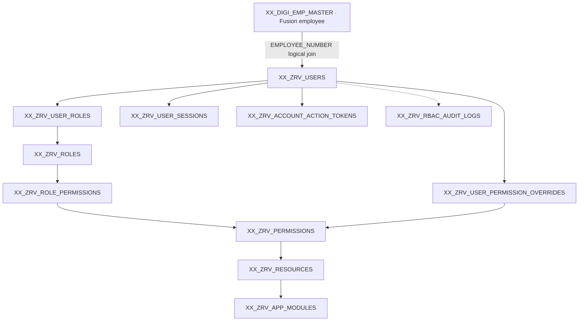

# Zamil Revamp — RBAC Database Documentation Index
> **Status:** All 11 table designs (122 columns) approved and locked on 17 October 2026. These files are permanent **design references**, not evidence that tables exist in a live database. No DDL or code has been executed.

## Scope and approved inventory
| Order | Finalized table | Columns | Primary responsibility | Status |
|---:|---|---:|---|---|
| 01 | [XX_ZRV_USERS](01-XX_ZRV_USERS.md) | 16 | User identities and local authentication | APPROVED AND LOCKED |
| 02 | [XX_ZRV_ROLES](02-XX_ZRV_ROLES.md) | 9 | Role definitions | APPROVED AND LOCKED |
| 03 | [XX_ZRV_APP_MODULES](03-XX_ZRV_APP_MODULES.md) | 10 | Functional application module catalog | APPROVED AND LOCKED |
| 04 | [XX_ZRV_RESOURCES](04-XX_ZRV_RESOURCES.md) | 10 | Protected business capabilities | APPROVED AND LOCKED |
| 05 | [XX_ZRV_PERMISSIONS](05-XX_ZRV_PERMISSIONS.md) | 9 | Resource-specific actions | APPROVED AND LOCKED |
| 06 | [XX_ZRV_USER_ROLES](06-XX_ZRV_USER_ROLES.md) | 9 | User-to-role memberships | APPROVED AND LOCKED |
| 07 | [XX_ZRV_ROLE_PERMISSIONS](07-XX_ZRV_ROLE_PERMISSIONS.md) | 8 | Role-to-permission grants | APPROVED AND LOCKED |
| 08 | [XX_ZRV_USER_PERMISSION_OVERRIDES](08-XX_ZRV_USER_PERMISSION_OVERRIDES.md) | 11 | Individual ALLOW/DENY exceptions | APPROVED AND LOCKED |
| 09 | [XX_ZRV_USER_SESSIONS](09-XX_ZRV_USER_SESSIONS.md) | 13 | Opaque server-managed authenticated sessions | APPROVED AND LOCKED |
| 10 | [XX_ZRV_ACCOUNT_ACTION_TOKENS](10-XX_ZRV_ACCOUNT_ACTION_TOKENS.md) | 11 | One-time account recovery/action credentials | APPROVED AND LOCKED |
| 11 | [XX_ZRV_RBAC_AUDIT_LOGS](11-XX_ZRV_RBAC_AUDIT_LOGS.md) | 16 | Append-only security audit trail | APPROVED AND LOCKED |

**Integrity total:** 11 tables; 122 distinct approved columns across table schemas. The previously discussed `XX_ZRV_DEPARTMENTS` is intentionally excluded following the explicit integration decision. It was removed from the RBAC design scope, **not physically dropped**. `XX_DIGI_EMP_MASTER` remains the authoritative existing Oracle Fusion employee master and is not part of these 11.

## Recommended reading order
Read the table files in the numbered order above, then review the effective-authorization chain below, all **Not Confirmed** items, and each table’s section M (documented SQL snapshot). For implementation work, separately read the six approved backend architecture files in `server/docs/` and validate the application-specific rules.

## Cross-table conceptual authorization

## Core authorization precedence — approved
1. Reject invalid/revoked/expired sessions, inactive local accounts, ineligible Fusion employees and missing MFA where required.
2. Require the requested module, resource and permission to be active.
3. Evaluate the user’s **active, unexpired direct override**: DENY denies; ALLOW may authorize independently of a role, but **cannot bypass mandatory security/record scope**.
4. If no effective override, aggregate grants from all active, unexpired USER_ROLES referencing active ROLES and active ROLE_PERMISSIONS.
5. If no valid ALLOW, deny by default. Even when allowed at RBAC level, enforce domain-specific record/plant/organizational restrictions separately in Node.js.
6. Audit significant security decisions and all privileged changes without logging secrets.

## Technical standards
- **Scope:** single-company enterprise app; no SaaS tenant dimension. `XX_DIGI_EMP_MASTER` remains the authoritative Fusion employee profile, and `XX_ZRV_DEPARTMENTS` was removed by explicit decision.
- **Platform:** React frontend, Node.js 24 / Express 5 API, JavaScript ES modules, Oracle Autonomous Database, existing CI3 integration preserved. Backend modular monolith with feature/submodule-first routes/controllers/services/repositories, centralized session/permission middleware and shared data access.
- **SQL discipline:** parameter binding, verified identifiers, centralized Oracle pools; normal RBAC CRUD uses the approved LOW workload profile, with explicit service-owned transaction boundaries; no live schema changes in this documentation package.
- **Time:** event timestamps are `TIMESTAMP(6) WITH TIME ZONE` and normalized to UTC; show instants in KSA `Asia/Riyadh`, independently of India developer timezone. Oracle `DATE` applies only to genuine date-only business values, not these audit events.
- **IDs:** Oracle `NUMBER(19,0)` can exceed JavaScript safe integer precision; Node.js must bind/read IDs losslessly (e.g. strings), never silently round.
- **Security:** default DENY; backend is the security authority; React visibility is advisory; record/plant/organization scopes require separate verified business checks. Never copy sensitive Fusion HR/payroll details into RBAC records or frontend state.
- **Audit convention:** `CREATED_AT` always required UTC; `CREATED_BY` is attributable authenticated actor except documented bootstrap/unauthenticated exceptions; `UPDATED_AT`/`UPDATED_BY` initially NULL. Security-sensitive changes must produce suitable RBAC audit events.

## Reconciliation and inconsistency review
- **Approved inventory:** 11 exact table names and 122 columns reconciled with existing unexecuted SQL snapshot. All columns are covered individually in the file whose filename exactly matches its table name.
- **Parent/child foreign keys:** every physical RBAC FK from the SQL snapshot points to an approved 11-table parent. Approved business joins are not misrepresented as FKs.
- **Oracle employee linkage:** USERS.EMPLOYEE_NUMBER is VARCHAR2(60 BYTE), UNIQUE/NOT NULL on USERS only; uniqueness/correct row selection on XX_DIGI_EMP_MASTER is **Not Confirmed**. No physical FK added.
- **Credential separation:** password+active TOTP on USERS; session-token hash in USER_SESSIONS; account-action token hash in ACCOUNT_ACTION_TOKENS; no plaintext secrets in audit.
- **Status precedence:** inactive roles/modules/resources/permissions and expired/inactive grants do not provide access. Individual override DENY dominates role grants; ALLOW never bypasses mandatory restrictions.
- **Audit policy:** both UPDATED_* columns in RBAC_AUDIT_LOGS are intentionally present but enforced NULL; append-only runtime controls and a trigger were present in the existing SQL snapshot.
- **DDL vs decisions:** the included SQL is an *earlier authored reference snapshot* and has not been compiled against a target Oracle database. Any unverified Oracle syntax/semantics or integration details are implementation validation gates, not retroactive changes to approved design.

## Open items — do not misread as approved
| Area | Open item / required action |
|---|---|
| Fusion HR | Verify EMPLOYEE_NUMBER uniqueness, current/primary assignment selection, employee-number changes, sync freshness and eligibility policy; physical parent FK is not approved. |
| Credentials / MFA | Confirm pending-enrollment security lifecycle, KMS/encryption key custody/rotation, authenticator-replacement recovery procedures, broader MFA rollout and factor-reset protection. |
| Session policy | Choose and approve idle timeout, absolute timeout, reauthentication and session-data retention. |
| Recovery | Verify trusted recovery channel, issuance lifetimes and identity proofing for MFA_RECOVERY. |
| Authoritative administration | Document initial account/role bootstrap and future automated-service actor attribution without violating nullable CREATED_BY rules. |
| Security operations | Approve RBAC event code catalog, audit retention/export policy, monitoring and protected storage. |
| Oracle implementation | Compile DDL on nonproduction ADW, verify grants/privileges, NUMERIC precision-safe ID handling, UTC/timezone behavior, index footprint and actual table existence. |
| Architecture documents | Full text of approved backend architecture documents 03–06 was not directly retrievable this run; consistency with those exact versions requires a final human/source check. 01 and 02 were located through Library search. |
## CREATE TABLE statements and use of this package
Every table document contains section **M** with the complete `CREATE TABLE` statement reproduced verbatim from the prior, unexecuted SQL script; separate supporting `CREATE INDEX` statements are included when present in that script, and the audit document includes the existing append-only trigger. **No script or schema modification was executed** to produce this package. The user’s instruction to include CREATE TABLE statements was applied as a documentation-only request and does not authorize execution.

## Cross-reference to approved backend architecture documents
- `server/docs/01-SYSTEM_ARCHITECTURE.md` — modular monolith, feature-first components and backend-owned authorization.
- `server/docs/02-API_DEVELOPMENT_STANDARDS.md` — Joi/OpenAPI 3.1 standards, validation and API behavior.
- `server/docs/03-ORACLE_DATABASE_ARCHITECTURE.md` — approved Oracle/connection/transaction standards; **full text not verified in this task**.
- `server/docs/04-AUTHENTICATION_RBAC_SECURITY.md` — central authentication/RBAC policy; **full text not verified in this task**.
- `server/docs/05-CONFIGURATION_OPERATIONS.md` — configuration, secrets and logging; **full text not verified in this task**.
- `server/docs/06-ARCHITECTURE_DECISIONS_GUIDELINES.md` — final project decision register; **full text not verified in this task**.

**Document package generated:** 17 October 2026 · **Status:** architecture documentation snapshot, not a database deployment artifact.
